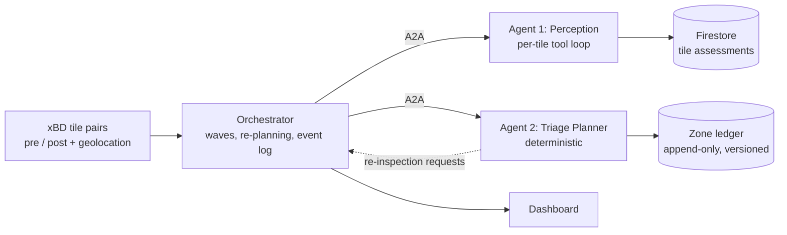

# TRIAGE

**Tile-level Reasoning for Impact Assessment and Grouped Evaluation**

A two-agent disaster-triage pipeline for satellite imagery. Given pre- and post-disaster tile pairs from the
[xBD / xView2](https://xview2.org/) dataset, TRIAGE assesses damage tile by tile, groups tiles into zones, and ranks the
zones by how urgently rescue teams should go there, taking **road access** into account as well as damage.

It was built as an agentic-AI course project (MTech, NMIMS MPSTME) and runs locally or as private services on Google
Cloud Run.

> **Status:** working end to end and deployed. The accuracy results are honest rather than flattering: the system ranks
> affected areas sensibly but over-calls severity on unseen disasters, so a human is meant to review the top zones.
> See [Results](#results-and-known-limits).

---

## Who it is for

An incident commander or dispatch coordinator with a handful of rescue teams and thousands of tiles to judge. The output
is a ranked, auditable list of zones, with uncertain tiles flagged for human review instead of silently guessed.

## How it works



**Agent 1 (Perception)** works on one tile at a time.
- A tool selector, either a fixed order or chosen by Gemini from the earlier attempts, picks the next tool. If the
  selector itself errors, it falls back to round-robin.
- Tool slots are a damage classifier, SAM, and a road-access detector. A tile is accepted only when a damage tool
  (classifier or SAM) reaches confidence **0.75**. The detector is auxiliary and runs once per tile.
- Tools are retried with backoff, with a fallback to another tool. A tile is **escalated** to human review when the tools
  are exhausted, when the image is unreadable, or when every tool fails.
- Each tile produces severity, confidence, and the full tool-call history (reasoning, evidence, score, latency, tokens).

**Agent 2 (Triage Planner)** is deterministic code. It does not use an LLM.
- Builds a haversine adjacency graph from real tile geolocation, so zones are spatial and never grouped just by score.
- Zone damage and zone access are each `0.5 * max + 0.5 * mean` over the zone's tiles. `priority = damage + access`, so
  blocked access can outrank higher raw damage.
- Neighbouring tiles whose scores are 2.0 or more apart are treated as a conflict and sent back for re-inspection rather
  than averaged.
- Writes an append-only, versioned `ZoneRanking` per batch. Escalated tiles surface as zones needing manual review, and
  tiles without geolocation are listed, not dropped.

**Orchestrator** drives both agents.
- Tiles stream to Agent 1 in waves, like a satellite pass. Agent 2 re-plans after every wave, so each wave is a ledger
  version.
- Re-inspection runs for at most 2 rounds with a per-tile cap of 2, and stops early if a round changes nothing. The second
  opinion tries SAM first.
- A tile that never reports is escalated as missing, and planning continues.
- Agents are called over A2A (Google ADK + a2a-sdk), with Cloud Run ID-token auth when deployed. If a remote call fails,
  an in-process fallback runs and the dashboard shows a visible `FALLBACK` badge.
- Every step is written to an append-only JSONL event log that feeds the dashboard, replay, and the audit trail.

**Dashboard** (FastAPI + vendored Leaflet, no CDN) shows the real xBD imagery at true footprints, tiles coloured by damage,
zones coloured by priority with rank badges, a version slider over the ledger history, a before/after slider, a per-tool
timeline (what Gemini saw, why a tool was chosen, confidence), a ground-truth toggle, replay at 1-10x, and a Run button.
A chip always states whether the run used **mock perception** or **Gemini vision**.

## Perception modes

| Mode | What runs | Use it for |
| --- | --- | --- |
| **mock** (default) | Hash-of-file-path stand-ins in `tools/classifier`, `tools/detector`, `tools/sam`; they ignore pixels | Tests, offline runs, plumbing demos |
| **vision** | `tools/vision`: Gemini 2.5 Flash on Vertex AI sees the before and after images | Real assessments |

In vision mode the tool names (`classifier`, `detector`, `sam`) are kept as roles because scoring is keyed on them; each
role is a Gemini prompt on the before/after pair, not a separate model. Two prompt variants exist: `classes` (one severity
level per tile, the default and the one used in the results below) and `fractions` (share of buildings per level,
giving a continuous score). They tied in evaluation. Answers are cached on disk by image content, prompt, model and
version.

## Repository layout

```
agents/
  perception/     Agent 1: loop, tool selector (llm_selector, prompts), schemas
  planner/        Agent 2: adjacency, scoring, conflict detection, schemas
  orchestrator/   pipeline, runner, A2A services/client/auth, events, audit_log, evaluation
tools/            classifier, detector, sam (mocks) and vision (Gemini)
shared/           config, Gemini/Claude Vertex clients, Firestore, georef, tile validation, truth, stores
dashboard/        server.py + static/ (index.html, app.js, state.js, style.css, vendor/leaflet)
scripts/          command-line entry points (see below)
deploy/           preflight.sh, deploy.sh, smoke_test.sh, stage_context.py, Dockerfile
tests/            unit, integration-style, security, and a node test for the dashboard logic
data/             NOT committed (xBD licence is non-commercial)
```

## Setup

Requirements: Python 3.11 and conda (Apple Silicon and Linux tested). The Google Cloud pieces are only needed for real
vision, Firestore, and deployment.

```bash
conda env create -f environment.yml        # creates the `triage` environment
conda activate triage
python -m pytest tests/                    # whole suite, no cloud access needed
```

Google Cloud auth uses Application Default Credentials. **No API keys are used or stored.**

```bash
gcloud auth application-default login
gcloud config set project <YOUR_PROJECT_ID>
cp .env.example .env                        # then fill in the values
```

### Data

TRIAGE uses the xBD test set. Download it yourself from the xView2 site, accept its non-commercial licence, and place it
under `data/` (the code expects `data/xbd_test`). Never commit anything under `data/`. Scripts that prepare the data
(run each with `--help`):

- `scripts.build_geo_file` builds the tile geolocation file
- `scripts.select_demo_tiles --informative` picks informative tiles per disaster
- `scripts.build_footprints` builds building footprints for the dashboard overlay
- `scripts.eda_xbd` exploratory statistics and charts

## Running it

Run everything as modules from the repository root.

```bash
# Offline pipeline (in-memory store, mock perception), no cloud needed
python -m scripts.run_e2e --disaster hurricane-harvey --offline

# Same, with real Gemini vision (needs Vertex AI access)
python -m scripts.run_e2e --disaster hurricane-harvey --offline --tools vision --vision-variant classes

# Dashboard
export TRIAGE_VISION_VARIANT=classes
export TRIAGE_VISION_CACHE=$(mktemp -d)
python -m dashboard.server                  # open http://127.0.0.1:8080
```

In the dashboard you can tick Real vision, Gemini tool selection and Simulated live feed, and choose the A2A or
in-process transport.

### Other scripts

| Script | Purpose |
| --- | --- |
| `scripts.run_e2e` | One full run (Agent 1, Agent 2, re-inspection, report) |
| `scripts.run_local_batch`, `scripts.run_planner_batch` | Run Agent 1 or Agent 2 on a batch on its own |
| `scripts.serve_agents` | Serve an agent as an A2A service (`--agent perception` or `planner`) |
| `scripts.evaluate_run` | Score a run against xBD ground truth (`--details`, `--min-buildings`) |
| `scripts.ab_vision` | Compare prompt variants on the same tiles (`--live` starts from an empty cache) |
| `scripts.cost_report` | Cost and time per tile, extrapolated (`--tiles 1000`) |
| `scripts.show_prompts` | Print every prompt in use (`> prompts.md`) |
| `scripts.migrate_tiles_to_batches`, `scripts.cleanup_placeholders` | Firestore maintenance |

### Configuration

| Variable | Meaning |
| --- | --- |
| `GCP_PROJECT_ID`, `VERTEX_AI_LOCATION` | Project and region for Vertex AI and Firestore (default region `us-central1`) |
| `USE_MOCK_TOOLS` | `true` uses the mock tools unless vision is requested |
| `TRIAGE_VISION_VARIANT` | `classes` or `fractions` |
| `TRIAGE_VISION_CACHE` | Directory for cached Gemini answers |
| `VISION_MODEL` | Gemini model name |
| `TRIAGE_STORE` | `firestore` or an in-memory store |
| `TRIAGE_ALLOW_RUN` | Enables the dashboard's Run button |
| `TRIAGE_A2A_AUTH` | `id_token` to sign calls with Cloud Run ID tokens |
| `TRIAGE_AGENT1_URL`, `TRIAGE_AGENT2_URL` | Where the dashboard finds the agent services |
| `TRIAGE_PUBLIC_URL` | The address an agent advertises on its agent card |
| `TRIAGE_JSON_LOGS` | `1` writes structured JSON audit lines to stdout (Cloud Logging) |

## Deploying to Google Cloud Run

Three **private** services are built from one image: `triage-agent1`, `triage-agent2`, and `triage-dashboard`. Nothing is
public, and each service runs as its own service account with only the roles it needs (Agent 1 can call Vertex AI and
nothing else; Agent 2 needs no Google API; the dashboard uses Firestore and Vertex AI).

```bash
bash deploy/preflight.sh                    # checks APIs, org policy, and access
bash deploy/deploy.sh                       # everything; DRY_RUN=1 prints without changing
bash deploy/smoke_test.sh                   # private access, agent cards, a full A2A run
gcloud run services proxy triage-dashboard --region us-central1 --port 8080   # then open http://localhost:8080
```

`deploy.sh` can also run a single step, for example `STEP=build bash deploy/deploy.sh`. Settings come from the
environment: `PROJECT`, `REGION`, `REPO`, `VISION_VARIANT`, `VISION_CACHE` (`baked` serves cached answers, `live` starts
empty), `TRIAGE_STORE`, `ALLOW_RUN`.

Things to know:

- **Access is by proxy.** If your organisation blocks public access (a domain-restricted-sharing policy), a browser gets
  a 403 on the service URL. The proxy command above adds your identity token.
- **Agent card URLs.** Cloud Run can report a different URL form than the one `deploy.sh` predicts. When it does, the
  script prints a warning with the fix:
  `gcloud run services update <service> --region <region> --update-env-vars TRIAGE_PUBLIC_URL=<real URL>`, and the
  dashboard's `TRIAGE_AGENT1_URL` / `TRIAGE_AGENT2_URL` should use the same real URLs.
- **Re-running the whole script resets environment variables** because it uses `--set-env-vars`. To ship new code
  without that, run `STEP=stage` and `STEP=build`, then
  `gcloud run services update <service> --image <image> --update-env-vars ...`.
- **Cloud Build permissions.** If the build fails with a 403 on the Cloud Build bucket, grant
  `roles/cloudbuild.builds.builder` to the project's Compute default service account.
- `deploy/_context/` is generated by `deploy/stage_context.py` and is gitignored.
- Services scale to zero when idle. The first request after a quiet period can take 10-20 seconds.

## Logging and security

- `TRIAGE_JSON_LOGS=1` writes one structured line per tool call, per failed attempt, and per escalation to stdout, which
  Cloud Run ships to Cloud Logging. Fields are a **whitelist**: model reasoning and "sees:" text, image paths, service URLs
  and unknown fields are never logged, and free text is truncated and scrubbed of key-shaped strings. The full detail
  stays in `data/runs/<run_id>/events.jsonl`. See `agents/orchestrator/audit_log.py`.
- Filter a run in Logs Explorer with `jsonPayload.run_id="<run id>"`.
- Prompt-injection text in tile metadata does not redirect the agents (`tests/security`), and a scan checks tracked
  source for hard-coded secrets.
- Private services, ID-token auth between services, and per-service service accounts.

## Testing

```bash
python -m pytest tests/                     # about 351 tests
```

Tests cover both agents, the orchestrator, A2A transport, batch isolation, fault handling, evaluation, deployment
tooling, the dashboard server, and the dashboard's front-end logic (run under node). New tests are mutation-checked:
the code is broken on purpose to prove the test can fail.

Coverage of the 26-case test specification: **21 verified**, 3 partial (PER-05, SEC-02, SEC-03), 2 open (NF-02 new
disaster type, NF-03 large-batch load). SEC-04 (Agent 1 cannot write to BigQuery or Firestore) is verified through an IAM
evaluation, not a live refused write.

## Results and known limits

Measured with real Gemini on xBD, `classes` variant. "Error" is tile-level severity error against xBD ground truth as
computed by `scripts.evaluate_run`; the baseline is a constant guess.

| Area | Error | Constant-guess baseline | Notes |
| --- | --- | --- | --- |
| Development areas, pooled (tiles with at least 10 buildings) | 0.46 | 0.74 | within one level 0.83; rank correlation 0.75 |
| Hurricane Harvey | 0.22 | 0.96 | strongest area |
| Held-out areas (Hurricane Michael, SoCal fire) | 0.87 | 0.39 | rank correlation 0.49 |

Cost and speed (16 Harvey tiles, empty cache, 4 workers): about **$0.00072 per tile** (two calls, roughly 1,590 input and
96 output tokens), **35 s** wall-clock, median call about 3 s, p95 about 10 s. A cache replay takes about 2 s and costs
nothing. These figures exclude tool-selector calls and second opinions.

Known limits:

- The system ranks tiles sensibly but **over-calls severity on unseen disasters**; wildfire was worse than a constant guess.
- Gemini is not repeatable run to run (one wildfire variant scored 0.51, then 0.85).
- Gemini's confidence is saturated at 0.8-0.9, so escalation rarely fires on real output.
- Tile-level severity is compared against per-building xBD labels; evaluation samples are small, and demo areas were chosen
  for variety. The Mexico earthquake demo area has no damaged tiles and acts as a negative control.
- There is no per-call Gemini timeout yet, so an occasional ~100 s outlier occurs.
- Tiles run through one batch service, not one Cloud Run job each. The zone ledger is a local JSONL file
  (`data/zone_rankings.jsonl`) because BigQuery was blocked by an organisation policy in the development project.

Planned next: a per-call timeout and retry, confidence calibration, re-inspecting tiles that only escalated, and the
open NF-02 / NF-03 cases.

## Data and licence

The xBD dataset is released for non-commercial use; do not commit or redistribute it. The project's own code is covered by
the `LICENSE` file in this repository.

## Acknowledgements

The xView2 / xBD team for the dataset, and Google Cloud for the free-trial credit used for deployment.

## References

- Gupta, R. et al. "Creating xBD: A Dataset for Assessing Building Damage from Satellite Imagery." CVPR Workshops, 2019.
- Kirillov, A. et al. "Segment Anything." ICCV, 2023.
- Chen, Z., Shamsabadi, E. A., Jiang, S., Shen, L., Dias-da-Costa, D. "Integration of large vision language models for
  efficient post-disaster damage assessment and reporting" (DisasTeller). arXiv:2411.01511.
- Google Agent2Agent (A2A) protocol and Agent Development Kit (ADK) documentation.